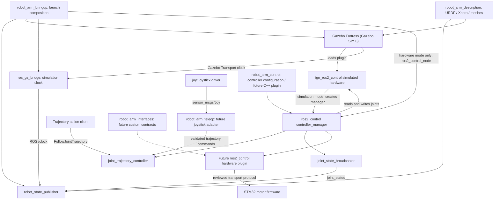

# Architecture

Target: Ubuntu 22.04 LTS / ROS 2 Humble / Gazebo Fortress (Gazebo Sim 6). Phase 1B provides a headless launch for the illustrative six-joint reference model. The diagram shows the planned simulation and hardware architecture. ROS 2 remains Humble. Use its Fortress-compatible integration, including the Ignition names retained in Humble-era APIs.

Simulation and physical hardware are mutually exclusive backends for the same six-joint controller contract. Description owns geometry, inertias, limits, and later ros2_control declarations. Control owns controller configuration and later a C++17 hardware plugin. Bringup owns composition and startup ordering; it must not own control algorithms. Teleop is an ament_python package for later input translation. Interfaces is an ament_cmake package reserved for custom contracts only when standard ROS messages are insufficient; no interfaces are generated yet.

In Gazebo Fortress mode, the `ign_ros2_control` plugin creates the controller manager inside Gazebo. Bringup starts Gazebo, spawns the robot, then loads controllers through that manager's services; it must not start a second `ros2_control_node`. In physical hardware mode, bringup instead starts `ros2_control_node` with the future hardware plugin. The shared manager node in the diagram represents these mutually exclusive alternatives.

Fortress is Gazebo Sim major version 6. Use `ros_gz_sim` for spawning and simulator launch integration, and `ros_gz_bridge` for selected Gazebo Transport topics such as the simulation clock. Joint states and trajectory commands use the ros2_control ROS interfaces directly. In simulation, enable `use_sim_time` consistently for ROS nodes and bridge `/clock`; the diagram shows robot_state_publisher as one consumer. The Humble/Fortress control integration retains the historical `ign_ros2_control` package name. Plugin class and library identifiers must be checked against the installed Humble/Fortress version when the model is implemented; no plugin declarations are present in this scaffold.

Current package dependencies cover the scaffold's intended description, launch, controller, and Python roles. Controller integration, `control_msgs`, and `joy` are planned dependencies, not claims of installed or implemented features. Declare them in the consuming package when that feature is introduced. The reserved C++ include/source directories contain no library and are deliberately not installed. Asset directories are installed under `share/<package>`; teleop also registers its ament resource marker and Python module.

The Phase 1A reference model uses `joint_1` through `joint_6` with illustrative Z/Y/Y/X/Y/Z axes. Dimensions, limits, inertias, and frames are not physical hardware specifications; update rates and controller tuning still require review. No physical dimensions or motor capabilities are assumed here.

Future packages to declare include `ign_ros2_control`, `control_msgs`, and later `joy`. The control package already declares the controller manager and both controllers as runtime dependencies. The teleop package already declares `trajectory_msgs`, `sensor_msgs`, and `rclpy` as runtime dependencies, and bringup also declares `sensor_msgs` and `rclpy` for its launch tests. RViz is an optional visualization tool. STM32 device access is not required for simulation development.

The Phase 1B launch in `robot_arm_bringup` expands the Xacro from `robot_arm_description` and passes it to `robot_state_publisher`. By default, `joint_state_publisher` supplies the reference pose on `/joint_states`. External joint states can replace that source for kinematic inspection. RViz is opt-in and uses `base_link` as the fixed frame. See the [reference model guide](reference_robot_model.md).

Phase 2A adds a Fortress world in bringup and a standalone system test for gravity,
conversion and spawning, the Gazebo-to-ROS clock bridge, and shutdown/restart.
Bringup declares the ROS/Gazebo integration as test dependencies for this phase.
The test uses the existing illustrative arm with a free base and checks its
spawned joint inventory. See [Phase 2A validation](phase2a_smoke.md).
