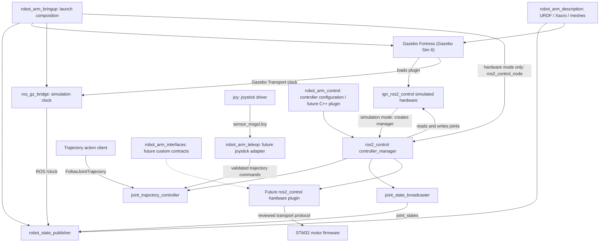

# Architecture

Target: Ubuntu 22.04 LTS / ROS 2 Humble / Gazebo Fortress (Gazebo Sim 6). This commit is a package scaffold; the runtime elements below are planned, not implemented. ROS 2 remains Humble. Use its Fortress-compatible integration, including the Ignition names retained in Humble-era APIs.

Simulation and physical hardware are mutually exclusive backends for the same six-joint controller contract. Description owns geometry, inertias, limits, and later ros2_control declarations. Control owns controller configuration and later a C++17 hardware plugin. Bringup owns composition and startup ordering; it must not own control algorithms. Teleop is an ament_python package for later input translation. Interfaces is an ament_cmake package reserved for custom contracts only when standard ROS messages are insufficient; no interfaces are generated yet.

In Gazebo Fortress mode, the `ign_ros2_control` plugin creates the controller manager inside Gazebo. Bringup starts Gazebo, spawns the robot, then loads controllers through that manager's services; it must not start a second `ros2_control_node`. In physical hardware mode, bringup instead starts `ros2_control_node` with the future hardware plugin. The shared manager node in the diagram represents these mutually exclusive alternatives.

Fortress is Gazebo Sim major version 6. Use `ros_gz_sim` for spawning and simulator launch integration, and `ros_gz_bridge` for selected Gazebo Transport topics such as the simulation clock. Joint states and trajectory commands use the ros2_control ROS interfaces directly. In simulation, enable `use_sim_time` consistently for ROS nodes and bridge `/clock`; the diagram shows robot_state_publisher as one consumer. The Humble/Fortress control integration retains the historical `ign_ros2_control` package name. Plugin class and library identifiers must be checked against the installed Humble/Fortress version when the model is implemented; no plugin declarations are present in this scaffold.

Current package dependencies cover the scaffold's intended description, launch, controller, and Python roles. Gazebo integration, `control_msgs`, and `joy` are planned dependencies, not claims of installed or implemented features. Declare them in the consuming package when that feature is introduced. The reserved C++ include/source directories contain no library and are deliberately not installed. Asset directories are installed under `share/<package>`; teleop also registers its ament resource marker and Python module.

Use `joint_1` through `joint_6` consistently once the model is introduced. Frame names, joint axes, limits, inertias, update rates, and controller tuning require review in phase 1. No physical dimensions or motor capabilities are assumed here.

Planned dependencies: xacro, robot_state_publisher, ros_gz_sim, ros_gz_bridge, ign_ros2_control, controller_manager, joint_state_broadcaster, joint_trajectory_controller, control_msgs, trajectory_msgs, sensor_msgs, rclpy, and later joy. RViz is an optional visualization tool. STM32 device access is not required for simulation development.

The repository currently has no executable nodes, launch files, robot model, controller YAML, or hardware driver. Directory README files mark ownership without suggesting these features work.
